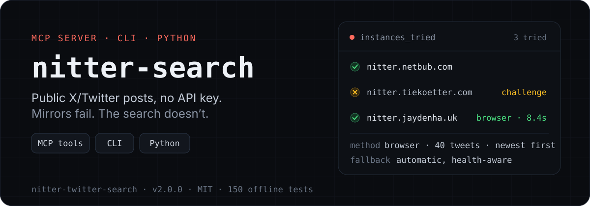
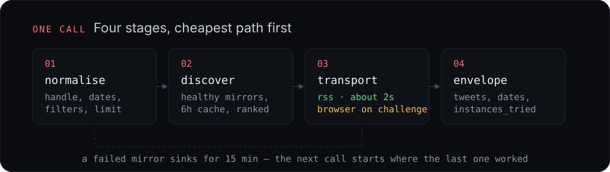

<p align="center">
  
</p>

<p align="center">
  
  
  
  
</p>

Nitter mirrors are volunteer-run and they die constantly. Most scrapers break when
that happens, because a mirror URL is baked into the code. This one discovers
mirrors at runtime, prefers the cheapest transport that works, falls back across
instances, and remembers which ones failed.

## Install

```bash
git clone https://github.com/shivam2014/nitter-twitter-search.git
cd nitter-twitter-search
pip install -e .
```

Optional, for mirrors that fingerprint the browser:

```bash
pip install -e '.[camoufox]' && camoufox fetch
```

Without Camoufox it still works: it falls back to Playwright's Chromium, then to
an installed Google Chrome, then to RSS-only mode.

## Use

### As MCP tools

```bash
opencode mcp add nitter --global -- "$(command -v nitter-search-mcp)"
```

Three tools appear: `user_tweets`, `search_tweets`, `list_nitter_instances`.
The server keeps a warm browser and a warm instance list between calls.

### From the shell

```bash
nitter-search --user NASA --limit 5
```

```json
{
  "search_metadata": {
    "user": "NASA",
    "mirror_used": "https://nitter.netbub.com",
    "method": "rss",
    "total": 5,
    "error": null,
    "instances_tried": [{"url": "https://nitter.netbub.com", "ok": true, "method": "rss"}]
  },
  "tweets": [
    {
      "id": "2114484649430798432",
      "url": "https://nitter.netbub.com/NASA/status/2114484649430798432",
      "text": "Have you put up your Halloween decor? The night sky will add the finishing touch...",
      "date": "2026-10-25T22:30:00Z",
      "author": "NASA",
      "likes": null
    }
  ]
}
```

Add `--stats` when engagement counts matter (switches to the browser path):

```bash
nitter-search --query "mars rover" --since 2026-10-01 --limit 20 --stats
```

`--text` prints one tweet per line, `--ndjson` prints one JSON object per line,
`--check` reports mirror health, `--instance URL` pins a mirror.

### From Python

```python
from nitter_search import search_tweets

result = search_tweets(user="NASA", limit=10)
for tweet in result["tweets"]:
    print(tweet["date"], tweet["text"])
```

## Why it holds up

<p align="center">
  
</p>

- **Discovery, not hard-coding.** Healthy mirrors come from `status.d420.de`,
  cached for six hours, filtered against known-dead hosts, and ranked by
  reliability. `nitter.net` has been offline since 2024 and is skipped by name.
- **RSS before browsers.** `/<user>/rss` is plain HTTP and answers in about two
  seconds. A browser only launches when the feed is challenge-gated or you asked
  for counts.
- **Challenge pages are not failures.** Anubis, "Gandalf" and Cloudflare gates
  are detected, cleared in a browser, and the resulting cookies are reused.
- **Session memory.** An instance that failed in the last fifteen minutes sinks
  in the queue, so repeated calls get faster instead of retrying dead mirrors.
- **Honest diagnostics.** `search_metadata.instances_tried` says which mirror was
  tried, over which transport, and why it was dropped.

## Filters

Passed straight to Nitter's query string, server-side:

```bash
nitter-search --query "mars" --filter media --min-faves 100 --min-retweets 10
```

| Filter | Flag | Notes |
|--------|------|-------|
| Date range | `--since`, `--until` | `YYYY-MM-DD`, inclusive |
| Media | `--filter media` | images, video, GIFs |
| Links | `--filter links` | tweets containing URLs |
| Quotes | `--filter quotes` | quote tweets |
| Replies | `--filter replies` | reply tweets |
| Minimum likes | `--min-faves N` | |
| Minimum retweets | `--min-retweets N` | |
| Minimum replies | `--min-replies N` | |

## What you get back

Every tweet carries `id`, `url`, `text`, `date` (ISO 8601 UTC), `author`,
`author_name`, `likes`, `replies`, `retweets`, `views`, `is_retweet`,
`retweeted_by`, `quote`, `pinned`, and `media` URLs.

`null` engagement means "not carried by this transport", not zero: the RSS path
has no counts. Request `--stats` for numbers.

Exit codes: `0` ok, `2` protected/missing account, `3` no results, `1` every
instance failed.

## Limits

- Public mirrors rate limit hard. A single call can return nothing; retry or pin
  another instance.
- Some mirrors disable search entirely ("Search has been disabled due to abuse").
  Those are skipped and the timeline endpoints still work.
- Protected accounts, deleted tweets, and age-restricted media are unreachable.
- RSS returns the newest ~20 items. Ask for more and the browser path paginates.
- This scrapes public pages through third-party mirrors. Use it for research and
  monitoring at a human pace, not for bulk harvesting.

## Development

```bash
./run_tests.sh          # 150 offline tests, under a second
nitter-search --check   # live mirror health
```

Tests never touch the network: HTTP payloads come from `tests/fixtures/`,
captured from live instances, and browser calls are faked. See
[tests/TESTING.md](tests/TESTING.md) for the fixture map and why v1's
"73 passing tests" were passing without testing anything.

```
src/nitter_search/
├── urls.py        URL building and validation
├── parse.py       HTML/RSS parsing, counts, dates, page classification
├── instances.py   discovery, health memory, probing
├── transport.py   http_get + BrowserSession (camoufox → chromium → chrome)
├── search.py      orchestration and the result envelope
├── mcp_server.py  stdio MCP server
└── cli.py         command line entry point
```

## License

MIT. See [LICENSE](LICENSE).

Built as an agent skill; the MCP server and CLI came later. Originally created
with [Hermes Agent](https://github.com/NousResearch/hermes-agent), rewritten for
v2 after public Nitter instances changed shape.
